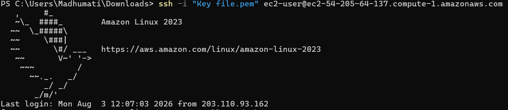
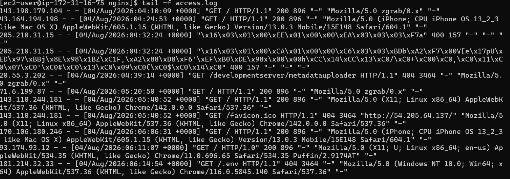
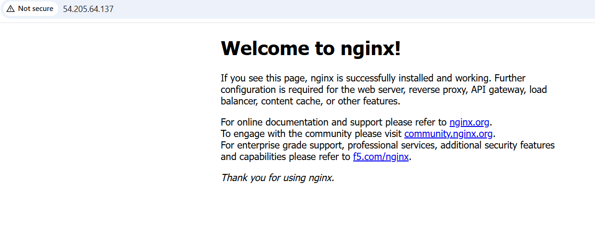

## Commands Used
-SSH
-SFTP
-Get
-lcd, lls
-cURL

## Challenges Faced
-couldn't access the nginx landing page easily

## What I Learned
-AWS ECS instances are cool.

## What I did
- SSH connection to the server

- Log file contents

- Nginx welcome page accessible from browser

