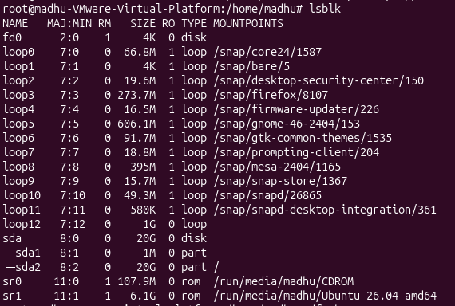
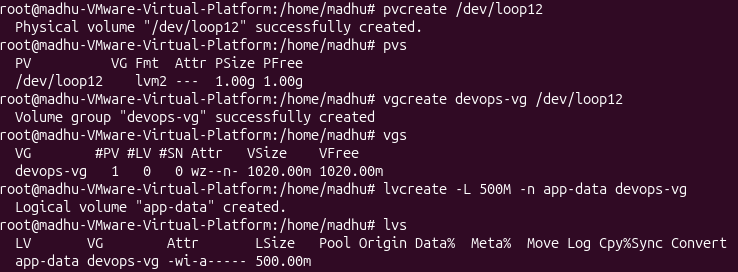
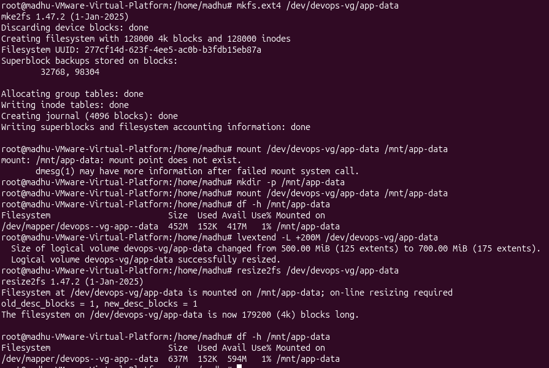

losetup -a   # Note the device name (e.g., /dev/loop0)
 /dev/loop12: [0039]:310 (/tmp/disk1.img)

first you create a pvs(physical volumes) and then create vgs(volume groups) and lvs(logical volumes). 
next you format the lvs and then mount them to a location to use.
you can even extend/resize the volume however you want later.